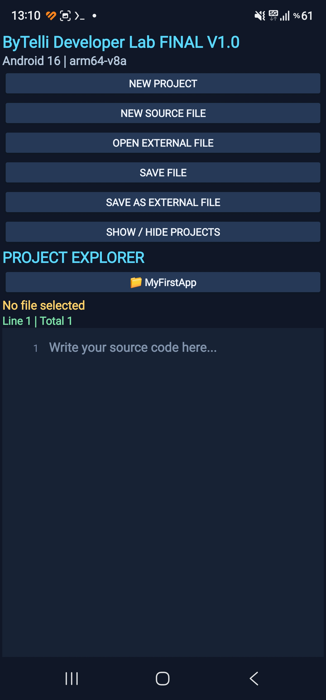
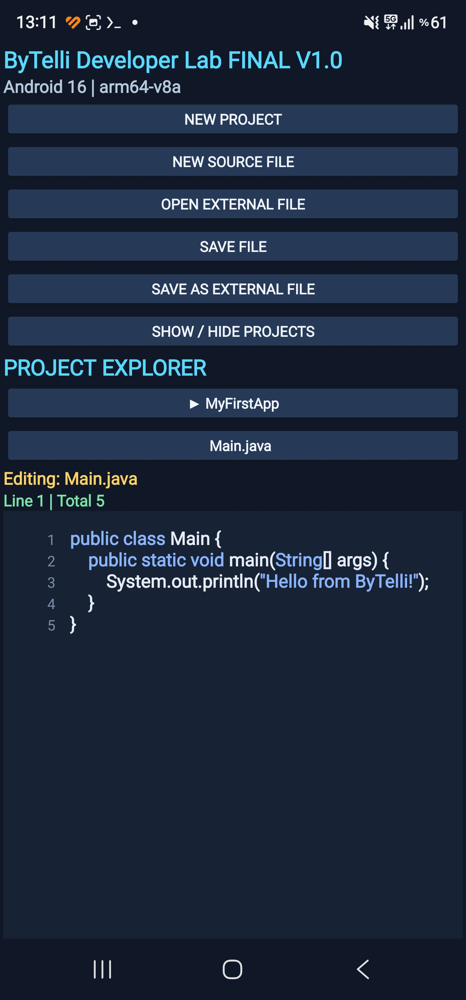

# ByTelli — Android Development, Right on Your Phone 🚀

**Build Android apps directly on your phone. No PC required.**

[](https://github.com/black1771/ByTelli-Termux/releases/tag/v1.0.0)
[](LICENSE)
[](CONTRIBUTING.md)
[](SUPPORT.md)

**English | [Türkçe](#türkçe)**

ByTelli is an independent, experimental Android development project built and tested **using an Android phone and standard Termux**. We share working source code, build instructions, troubleshooting notes, and a downloadable Android editor.

> **What makes this different?** The development workflow runs on the phone itself — including Java, Gradle and Android SDK setup. No desktop computer was used for the verified ByTelli Developer Lab build.

## 📱 Example app: ByTelli Developer Lab V1.0

**Developer Lab V1.0 is the example/demo APK for this repository.** It demonstrates the documented phone-only Android development workflow. It is not required to use the build guide and it is not the Android SDK.

The example itself is a lightweight Android **Java source editor** built entirely on an ARM64 phone.

### 📸 Real screenshots from Android 16

| Main screen and project explorer | Java editor with syntax highlighting |
|:--:|:--:|
|  |  |

Screenshots captured on the phone running the published V1.0 app.

**Features**
- Dark editor with basic Java syntax highlighting and line numbers
- Create projects and keep local files between sessions
- Open and save files with Android's Storage Access Framework
- Collapsible project explorer

**[⬇ Download APK — V1.0](https://github.com/black1771/ByTelli-Termux/releases/download/v1.0.0/ByTelliDeveloperLab-FINAL-V1.apk)** · **[📁 View source](examples/ByTelliDeveloperLabV1)** · **[📝 Release notes](https://github.com/black1771/ByTelli-Termux/releases/tag/v1.0.0)**

**Important:** V1.0 is an **example application** and source-code editor, **not** an on-device compiler or full APK-building IDE. The published APK is a **debug build**, not a production-signed Play Store release. Review source and verify downloads before installing.

## 🛠️ Build Android APKs using standard Termux

This repository also documents how to compile Android apps **inside regular Termux**, without a PC or a custom Termux fork.

**Verified Developer Lab build environment:** ARM64 Android / Java 25 / Gradle 9.6 / Android Gradle Plugin 8.7.3 / Android SDK platform 34 / Termux-native `aapt2`.

1. Install Termux from a [trusted official source](https://github.com/termux/termux-app#installation).
2. Follow the **[step-by-step guide: install Java + Android SDK + ARM64 AAPT2, build an APK and install it](docs/ANDROID-APK-BUILD.md)**.
3. Explore the **[Developer Lab V1 source](examples/ByTelliDeveloperLabV1)**.
4. Check **[build status and known limitations](docs/BUILD-STATUS.md)**.
5. Use **[`scripts/check-environment.sh`](scripts/check-environment.sh)** to inspect your environment.

### ⚡ Guided setup + one-command example build

After you manually download Google's official Android **command-line tools ZIP**, the helper can prepare the verified SDK 34 layout:

```sh
git clone https://github.com/black1771/ByTelli-Termux.git
cd ByTelli-Termux
bash scripts/setup-android-build.sh ~/storage/downloads/commandlinetools-linux-*.zip
```

Review and accept Google's SDK licenses yourself when prompted, then build the example with:

```sh
bash scripts/build-example.sh
```

On success the helper also copies `ByTelliDeveloperLab-V1-debug.apk` to Android Downloads when Termux storage access is available.

**Safety/design:** the setup helper does not download Google's SDK ZIP for you, does not auto-accept licenses, and does not silently install APKs. Package availability and device compatibility can vary.

## 🧰 Byblack Dev Tool

The repository now includes an interactive helper for the phone-only workflow:

```sh
git clone https://github.com/black1771/ByTelli-Termux.git
cd ByTelli-Termux
bash scripts/bytelli-dev.sh
```

From the menu you can check the environment, prepare the SDK, create a minimal Android Java project, build a project, build the example app, and locate generated APK files.

To create a new app directly:

```sh
bash scripts/new-android-project.sh
```

Enter an app name such as `MyApp` and a unique package such as `com.example.myapp`. The generator creates a minimal Java Android project configured for the repository's verified SDK 34 / ARM64 AAPT2 workflow.

> **Experimental:** test the generated project on your device before relying on it for production work. The generated APK is a debug build.

## 🤝 Help make ByTelli better

⭐ **Star this repository** if the project interests you.

🐛 [Report a bug](https://github.com/black1771/ByTelli-Termux/issues/new) — include device, Android version, expected/actual behavior and reproduction steps.

💡 [Suggest a feature](https://github.com/black1771/ByTelli-Termux/issues/new) — tell us what would make phone-only development easier.

🔧 [Contribute a fix](CONTRIBUTING.md) — documentation, Android compatibility and editor improvements are welcome.

❤️ [Support development / optional crypto donations](SUPPORT.md) — donations are voluntary, not required to use the project.

## Türkçe

**ByTelli — Bilgisayarsız, doğrudan Android telefonunda uygulama geliştir!**

Bu depo, **normal Termux** üzerinden Android APK derleme deneyimlerini, kaynak kodlarını ve karşılaşılan sorunların çözümlerini paylaşır.

- **[ByTelli Developer Lab V1.0 APK indir](https://github.com/black1771/ByTelli-Termux/releases/tag/v1.0.0)**
- **[Uygulamanın kaynak kodu](examples/ByTelliDeveloperLabV1)**
- **[Sıfırdan SDK kurulumu, APK derleme ve telefona yükleme](docs/ANDROID-APK-BUILD.md)**
- **[Hata bildir / öneri gönder](https://github.com/black1771/ByTelli-Termux/issues)**
- **[Projeye destek ol](SUPPORT.md)**

**Not:** Developer Lab V1.0 bu deponun **örnek/demo APK'sıdır**. Telefonda uygulama geliştirme ve derleme yönteminin çalışan örneğini gösterir. Kod düzenleyicisidir; kendi içinde APK derlemez. APK, test amaçlı debug sürümüdür. Termux üzerinden APK derlemek için SDK ve araçların ayrıca kurulması gerekir.

**Kolay kurulum:** Google'ın resmi command-line tools ZIP dosyasını kendiniz indirdikten sonra `scripts/setup-android-build.sh` SDK 34 ortamını hazırlar; `scripts/build-example.sh` ise örnek APK'yı tek komutla derler. Lisans kabulü kullanıcıya bırakılır.

---

**Independent community project; not affiliated with the official Termux project.**

**Security:** Never share signing keys, access tokens, private keys, recovery phrases or sensitive logs. Do not execute unreviewed third-party scripts.

**License:** MIT — see [LICENSE](LICENSE).
