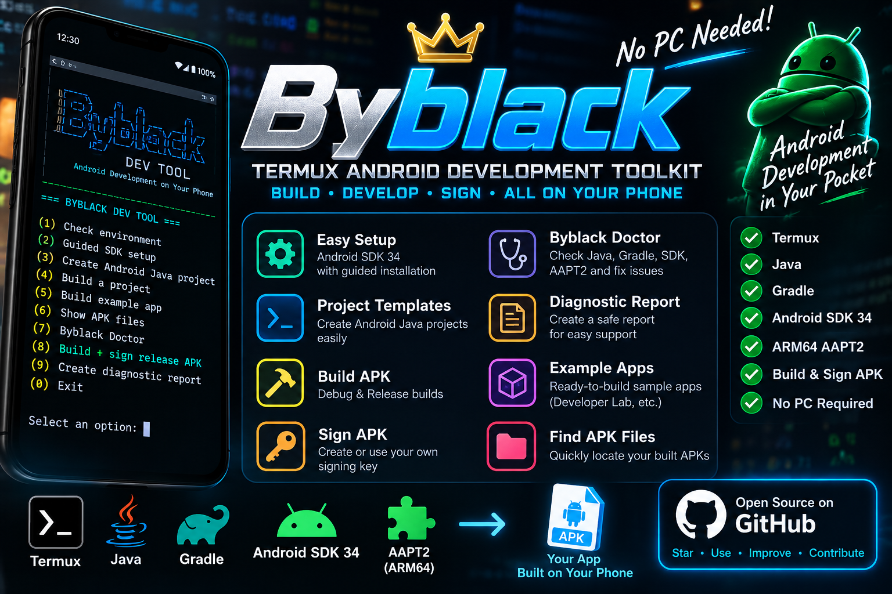
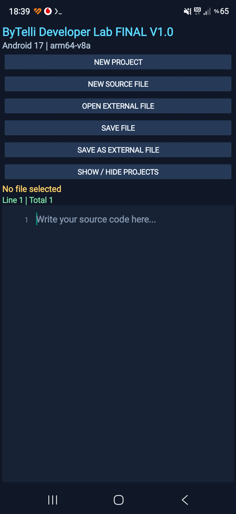

<p align="center">\n  \n</p>\n\n# Byblack — Android Development, Right on Your Phone 🚀

**Build Android apps directly on your phone. No PC required.**

[](https://github.com/black1771/ByTelli-Termux/releases/tag/v1.0.0)
[](LICENSE)
[](CONTRIBUTING.md)
[](SUPPORT.md)
[](https://github.com/black1771/ByTelli-Termux/actions/workflows/android-11-12-compatibility.yml)
[](https://github.com/black1771/ByTelli-Termux/actions/workflows/android-compatibility.yml)

**English | [Türkçe](#türkçe)**

Byblack is an independent, experimental Android development project built and tested **using an Android phone and standard Termux**. We share working source code, build instructions, troubleshooting notes, and a downloadable Android editor.

> **What makes this different?** The development workflow runs on the phone itself — including Java, Gradle and Android SDK setup. No desktop computer was used for the verified Byblack Developer Lab build.

## 🧮 ByBlack Calculator V2 — Scientific Calculator

A dark-themed scientific calculator built on an Android phone with Termux. The screenshot below shows the V2 interface running on a real device, including trigonometric functions, logarithms, history, and a calculation example.

<p align="center">
  
</p>

**[📁 View source code / Kaynak kodu](examples/ByBlackCalculator)** · **[🛠 Build instructions / Derleme rehberi](examples/ByBlackCalculator/README.md)**

**Türkçe:** ByBlack Calculator V2'nin Java kaynak kodu ve derleme dosyaları yayımlandı. Ekran görüntüsü gerçek Android cihazından alınmıştır. APK henüz bu bölümde yayımlanmadı; derleme için Android SDK 35 ve uygun Gradle/AAPT2 kurulumu gerekir.

## 📱 Example app: Byblack Developer Lab V1.0

**Developer Lab V1.0 is the example/demo APK for this repository.** It demonstrates the documented phone-only Android development workflow. It is not required to use the build guide and it is not the Android SDK.

The example itself is a lightweight Android **Java source editor** built entirely on an ARM64 phone.

### 📸 Real screenshots from Android 16

| Main screen and project explorer | Java editor with syntax highlighting |
|:--:|:--:|
|  |  |

Screenshots captured on the phone running the published V1.0 app.

### 📱 Android 17 — Samsung Galaxy S24 Ultra (real device)

The screenshot below shows **ByTelli Developer Lab running on a Samsung Galaxy S24 Ultra with Android 17**. This is a real-device screenshot, separate from the Android 10–15 emulator smoke tests.

<p align="center">
  
</p>

**Türkçe:** ByTelli Developer Lab, Android 17 yüklü Samsung Galaxy S24 Ultra üzerinde açılarak görüntülendi. Bu ekran görüntüsü gerçek cihazdan alınmıştır. Tek başına bütün özelliklerin Android 17 üzerinde test edildiği anlamına gelmez.


**Features**
- Dark editor with basic Java syntax highlighting and line numbers
- Create projects and keep local files between sessions
- Open and save files with Android's Storage Access Framework
- Collapsible project explorer

**[⬇ Download APK — V1.0](https://github.com/black1771/ByTelli-Termux/releases/download/v1.0.0/ByblackDeveloperLab-FINAL-V1.apk)** · **[📁 View source](examples/ByTelliDeveloperLabV1)** · **[📝 Release notes](https://github.com/black1771/ByTelli-Termux/releases/tag/v1.0.0)**

**Important:** V1.0 is an **example application** and source-code editor, **not** an on-device compiler or full APK-building IDE. The published APK is a **debug build**, not a production-signed Play Store release. Review source and verify downloads before installing.

## ✅ Verified Android 10–15 compatibility / Doğrulanmış uyumluluk

The **Byblack Developer Lab V1 example source** passed the GitHub Actions Android emulator smoke tests on **15 October 2026**:

| Android version | API level | APK build, install and launch |
| --- | ---: | --- |
| Android 10 | 29 | ✅ Passed |
| Android 11 | 30 | ✅ Passed |
| Android 12 | 31 | ✅ Passed |
| Android 13 | 33 | ✅ Passed |
| Android 14 | 34 | ✅ Passed |
| Android 15 | 35 | ✅ Passed |

**Evidence:** [Android 10/12](https://github.com/black1771/ByTelli-Termux/actions/runs/38712216857) · [Android 11](https://github.com/black1771/ByTelli-Termux/actions/runs/38725970949) · [Android 13–15](https://github.com/black1771/ByTelli-Termux/actions/runs/38709534580) · [Full report](TEST-REPORT.md)

The workflow compiles a **debug APK from repository source**, installs it in an **x86_64 GitHub-hosted emulator**, launches `com.bytelli.developerlab/.MainActivity`, and checks that the app process remains running. This is a **basic build/install/launch smoke test**, not proof that all editor, storage, Bluetooth, or other features work on every device. The separately reported Android 16 real-phone test used ARM64 Termux, not these emulators. The published release APK itself was not separately installed by this workflow.

**Türkçe:** Android 10, 11, 12, 13, 14 ve 15 için örnek uygulamanın kaynak kodundan APK derleme, emülatöre yükleme ve açılış testleri başarıyla tamamlandı. Kanıt bağlantısı yukarıdadır. Bu sonuç bütün özelliklerin veya her telefonun sorunsuz çalışacağını garanti etmez.

## 📂 Example app: Byblack File Manager V1

A second real Android Java example is now included: **[Byblack File Manager V1](examples/ByblackFileManager)**.

It uses Android's Storage Access Framework instead of broad storage permission. V1 can browse folders, open files, create folders, rename items and delete with confirmation. Long-press an item for file actions.

> Test destructive file operations on non-important files first.

## 🛠️ Build Android APKs using standard Termux

This repository also documents how to compile Android apps **inside regular Termux**, without a PC or a custom Termux fork.

**Verified Developer Lab build environment:** ARM64 Android / Java 25 / Gradle 9.6 / Android Gradle Plugin 8.7.3 / Android SDK platform 34 / Termux-native `aapt2`.

**Additional real-device build test (2026-10-15):** On standard Termux (Android 16, ARM64), the Developer Lab V1 example completed `gradle --offline --no-daemon assembleDebug` successfully with **Java 26.0.2 and Gradle 9.6.0**, running 31 Gradle tasks. The resulting debug APK was copied to Downloads. The Gradle version was subsequently confirmed as 9.6.0 (`Launcher JVM: 26.0.2`); app launch was not yet verified. An earlier attempt with the environment's default Java 21 failed with a native `PerfettoTrace` registration abort; the cause has not been isolated. Gradle officially supports running on Java 26 starting in **Gradle 9.4.0** ([compatibility matrix](https://docs.gradle.org/current/userguide/compatibility.html)).

To select Java 26 temporarily in standard Termux (if already installed), run:

```sh
export JAVA_HOME="$PREFIX/lib/jvm/java-26-openjdk"
export PATH="$JAVA_HOME/bin:$PATH"
java -version
gradle --version
```

This does not permanently replace your default Java. For a build, follow the SDK and native AAPT2 setup guide below; Java 26 alone is not sufficient.

1. Install Termux from a [trusted official source](https://github.com/termux/termux-app#installation).
2. Follow the **[step-by-step guide: install Java + Android SDK + ARM64 AAPT2, build an APK and install it](docs/ANDROID-APK-BUILD.md)**.
3. Explore the **[Developer Lab V1 source](examples/ByTelliDeveloperLabV1)**.
4. Check **[build status and known limitations](docs/BUILD-STATUS.md)**.
5. Use **[`scripts/check-environment.sh`](scripts/check-environment.sh)** to inspect your environment.

### ⚡ Guided setup + one-command example build

After you manually download Google's official Android **command-line tools ZIP**, the helper can prepare the verified SDK 34 layout:

```sh
git clone https://github.com/black1771/ByTelli-Termux.git
cd ByTelli-Termux
bash scripts/setup-android-build.sh ~/storage/downloads/commandlinetools-linux-*.zip
```

Review and accept Google's SDK licenses yourself when prompted, then build the example with:

```sh
bash scripts/build-example.sh
```

On success the helper also copies `ByblackDeveloperLab-V1-debug.apk` to Android Downloads when Termux storage access is available.

**Safety/design:** the setup helper does not download Google's SDK ZIP for you, does not auto-accept licenses, and does not silently install APKs. Package availability and device compatibility can vary.

## 🧰 Byblack Dev Tool

The repository now includes an interactive helper for the phone-only workflow:

```sh
git clone https://github.com/black1771/ByTelli-Termux.git
cd ByTelli-Termux
bash scripts/bytelli-dev.sh
```

From the menu you can check the environment, prepare the SDK, create a minimal Android Java project, build a project, build the example app, and locate generated APK files.

To create a new app directly:

```sh
bash scripts/new-android-project.sh
```

Enter an app name such as `MyApp` and a unique package such as `com.example.myapp`. The generator creates a minimal Java Android project configured for the repository's verified SDK 34 / ARM64 AAPT2 workflow.

> **Experimental:** test the generated project on your device before relying on it for production work. The generated APK is a debug build.

## 📱 Custom Android APK Requests / Özel APK İstekleri

Need a custom Android application? **[Request an APK through GitHub Issues](https://github.com/black1771/ByTelli-Termux/issues/new?template=custom-apk-request.yml)**. We review requests based on feasibility, scope and time; submission does not guarantee acceptance. [Details in English and Turkish](CUSTOM-APK-REQUESTS.md).

Özel Android APK yaptırmak mı istiyorsunuz? **[GitHub üzerinden APK isteği gönderin](https://github.com/black1771/ByTelli-Termux/issues/new?template=custom-apk-request.yml)**. Talepler uygunluk, kapsam ve süreye göre değerlendirilir. [Türkçe ve İngilizce ayrıntılar](CUSTOM-APK-REQUESTS.md).

**[📋 Changelog / Sürüm geçmişi](CHANGELOG.md)** · **[🧪 Test reports / Test raporları](TEST-REPORT.md)** · **[🐛 Structured bug report / Hata bildirim formu](https://github.com/black1771/ByTelli-Termux/issues/new?template=bug_report.yml)**

> CI badges show the most recent workflow result; emulator workflows run manually. The badges do not guarantee full app compatibility.

## 🤝 Help make Byblack better

⭐ **Star this repository** if the project interests you.

🐛 [Report a bug](https://github.com/black1771/ByTelli-Termux/issues/new?template=bug_report.yml) — include device, Android version, expected/actual behavior and reproduction steps.

💡 [Suggest a feature](https://github.com/black1771/ByTelli-Termux/issues/new) — tell us what would make phone-only development easier.

🔧 [Contribute a fix](CONTRIBUTING.md) — documentation, Android compatibility and editor improvements are welcome.

❤️ [Support development / optional crypto donations](SUPPORT.md) — donations are voluntary, not required to use the project.

## Türkçe

**Byblack — Bilgisayarsız, doğrudan Android telefonunda uygulama geliştir!**

Bu depo, **normal Termux** üzerinden Android APK derleme deneyimlerini, kaynak kodlarını ve karşılaşılan sorunların çözümlerini paylaşır.

- **[Byblack Developer Lab V1.0 APK indir](https://github.com/black1771/ByTelli-Termux/releases/tag/v1.0.0)**
- **[Uygulamanın kaynak kodu](examples/ByTelliDeveloperLabV1)**
- **[Sıfırdan SDK kurulumu, APK derleme ve telefona yükleme](docs/ANDROID-APK-BUILD.md)**
- **[Hata bildir / öneri gönder](https://github.com/black1771/ByTelli-Termux/issues)**
- **[Projeye destek ol](SUPPORT.md)**

**Not:** Developer Lab V1.0 bu deponun **örnek/demo APK'sıdır**. Telefonda uygulama geliştirme ve derleme yönteminin çalışan örneğini gösterir. Kod düzenleyicisidir; kendi içinde APK derlemez. APK, test amaçlı debug sürümüdür. Termux üzerinden APK derlemek için SDK ve araçların ayrıca kurulması gerekir.

**Kolay kurulum:** Google'ın resmi command-line tools ZIP dosyasını kendiniz indirdikten sonra `scripts/setup-android-build.sh` SDK 34 ortamını hazırlar; `scripts/build-example.sh` ise örnek APK'yı tek komutla derler. Lisans kabulü kullanıcıya bırakılır.

---

**Independent community project; not affiliated with the official Termux project.**

**Security:** Never share signing keys, access tokens, private keys, recovery phrases or sensitive logs. Do not execute unreviewed third-party scripts.

**License:** MIT — see [LICENSE](LICENSE).
