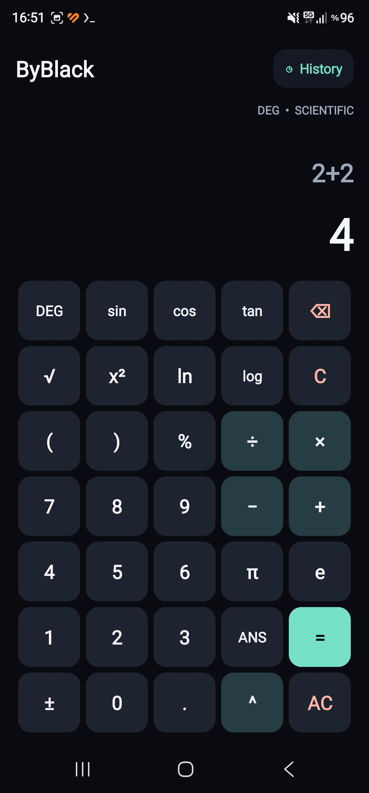

# ByBlack Calculator V2

Scientific Android calculator built with Java, Android Gradle Plugin 8.7.3 and Android SDK 35.

Features: dark UI, DEG/RAD trigonometry, square root, powers, logarithms, constants, percentages, saved calculation history and answer recall.



## Build / Derleme

Prerequisites: Java 17+ (compatible with your Gradle setup), Android SDK Platform 35, Android SDK build tools and Gradle 8.9+ or a compatible wrapper.

From this directory, set `ANDROID_HOME` to your installed SDK, then run:

```sh
gradle --no-daemon assembleDebug
```

APK: `app/build/outputs/apk/debug/app-debug.apk`.

### Termux ARM64

The original phone used a Termux-native AAPT2. The original `gradle.properties` contained an absolute path specific to that phone, so it has been removed from the public source. If Maven's Linux AAPT2 cannot run on your ARM64 Termux, find your native AAPT2 and add this line to your **local** `gradle.properties`:

```properties
android.aapt2FromMavenOverride=/your/actual/path/to/aapt2
```

Also create a local `local.properties` with `sdk.dir=/your/actual/android-sdk` if required.

**Türkçe:** Android SDK 35, Java, Gradle ve ARM64 uyumlu AAPT2 gerekir. SDK ve AAPT2 yollarını kendi cihazına göre ayarla. Bu kaynak koddan üretilen APK test/debug sürümüdür.

**Note:** This is the original V2 app source supplied by the author, excluding the V1 backup and machine-specific paths. No new full build was run on GitHub after publication.
