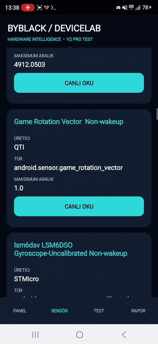

# ByBlack DeviceLab V3 Bilingual — Termux ile kaynak koddan APK

**Açık kaynak Android donanım tanılama uygulaması.** Bilgisayar veya root gerektirmeden, standart ARM64 Termux üzerinde APK derlenebilir. Derleme ortamı kurulumu internet ve depolama alanı gerektirir; önbellekte bağımlılıklar varsa derleme çevrimdışı yapılabilir.



## 1. Gerekli araçları kur

Önce [Android APK derleme kurulum rehberini](../../docs/ANDROID-APK-BUILD.md) takip et. Android SDK 34, ARM64 `aapt2`, Java, Gradle ve Android Gradle Plugin bağımlılıklarını kur. **Bu adımı atlama.** Kurulum tamamlanmadan aşağıdaki komut çalışmaz.

Standart Termux'ta depolama erişimini aç:

```sh
termux-setup-storage
```

## 2. Tek komutla derle

```sh
curl -fL https://raw.githubusercontent.com/black1771/ByTelli-Termux/main/scripts/build-devicelab-termux.sh -o build-devicelab-termux.sh && bash build-devicelab-termux.sh
```

`curl` yüklü değilse `pkg install curl` komutunu kullan. İndirdiğin betiği çalıştırmadan önce incele.

Başarılı derlemede APK: `/storage/emulated/0/Download/ByBlack-DeviceLab-V3-Bilingual.apk`.

## Önemli

- Kaynak: [Java ve Gradle dosyaları](.)
- Betik her çalışmada ayrı bir geçici proje klasörüne güncel kaynak kodunu indirir; mevcut projeleri değiştirmez.
- Derleme gerektiğinde Gradle/AGP bağımlılıklarını internetten indirir. GitHub Actions derlemesinin başarılı olması Termux ARM64 ortamında derlemenin de otomatik olarak başarılı olacağını garanti etmez.
- Bu proje **deneysel debug APK** üretir. Google Play için imzalı sürüm değildir.
- Kullanılan `targetSdk 28` modern Android dağıtımı için yükseltilmelidir; cihazdan cihaza uyumluluk değişebilir.
- APK otomatik yüklenmez. Yalnızca oluşturulur.
- **Gerçek Termux testi (19 Ekim 2026):** Samsung S24 Ultra üzerinde standart Termux ile `bash build.sh` başarılı: `BUILD SUCCESSFUL in 18s`, `31 actionable tasks: 31 executed`; APK `/storage/emulated/0/Download/ByBlack-DeviceLab-V3-Bilingual.apk` konumuna kopyalandı. Bu sonuç başka cihazlarda başarı garantisi değildir.

## English — Build from source in Termux

**ByBlack DeviceLab V3 Bilingual** is an open-source experimental Android hardware diagnostics app. You can build a debug APK on an ARM64 Android phone using standard Termux, without a PC or root. Initial setup requires an internet connection and several GB of free storage.

### Step 1 — Install the Android build tools

Follow the [full Android SDK setup guide](../../docs/ANDROID-APK-BUILD.md) to install Java, Gradle, Android SDK platform 34 and native ARM64 `aapt2`. Do not skip this step. Allow Termux to access shared storage:

```sh
termux-setup-storage
pkg install -y git curl
```

### Step 2 — Build the APK

```sh
curl -fL https://raw.githubusercontent.com/black1771/ByTelli-Termux/main/scripts/build-devicelab-termux.sh -o build.sh && bash build.sh
```

Review the script before running it. The script clones the latest public repository into a separate temporary directory, leaving your existing projects unchanged. Gradle downloads missing dependencies if needed.

**Output:** `/storage/emulated/0/Download/ByBlack-DeviceLab-V3-Bilingual.apk` when storage permission is available.

### Notes and verified result

- [Source code](.) is public. This produces a **debug APK**, not a production-signed Play Store release.
- APK creation does not install the app automatically.
- The project currently targets SDK 28; compatibility with other Android devices is not guaranteed.
- **Verified on 19 October 2026:** GitHub Actions compiled the APK successfully. A Samsung Galaxy S24 Ultra also built the repository source in standard ARM64 Termux in 18 seconds (31 Gradle tasks). Other devices have not been tested.

